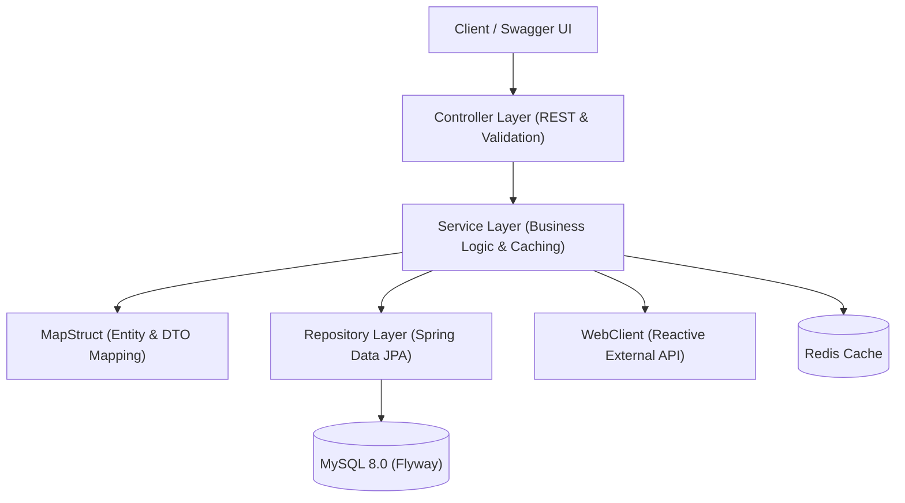

# Architecture Overview

This document outlines the architectural patterns, package structure, and data flow of **Store App**.

---

## 1. High-Level Architecture

### Request Flow
1. **Controller**: Handles HTTP requests and validates inputs (`@Valid`, `@Positive`, `@NotBlank`).
2. **Aspect (AOP)**: Intercepts execution to log method runtime.
3. **Service**: Runs business logic, checks Redis (`@Cacheable`), or queries MySQL via JPA.
4. **Mapper**: Converts internal Entities to DTOs via MapStruct before returning HTTP responses.

---

## 2. Package Structure

Source code is located under `src/main/java/org/example/store/`:

| Package | Responsibility |
| :--- | :--- |
| **`controller/`** | Exposes REST endpoints, Swagger docs, and input validation. |
| **`service/`** | Business logic, transactions, and Redis caching (`@Cacheable`, `@CacheEvict`). |
| **`repository/`** | Spring Data JPA access. Uses `@EntityGraph` to prevent N+1 queries. |
| **`model/entity/`** | JPA entities extending `BaseEntity` (audit timestamps). |
| **`model/dto/`** | Request and response contract schemas. |
| **`mapper/`** | MapStruct interfaces for compile-time Entity-DTO conversions. |
| **`config/`** | Configurations for Redis, WebClient, OpenAPI, and connection pooling. |
| **`aspect/`** | Spring AOP execution time logging (`TimeMeasurementAspect`). |
| **`exception/`** | Global exception handler (`@RestControllerAdvice`) returning clean error responses. |

---

## 3. Key Design Patterns

- **DTO Isolation**: Entities are never exposed directly to clients. MapStruct handles conversions to avoid contract coupling.
- **Caching**: Frequent reads use `@Cacheable`. Writes use `@CacheEvict(allEntries = true)` to clear stale data.
- **Flyway Migrations**: Database schema changes are strictly append-only in `src/main/resources/db/migration/`. Never edit existing scripts.
- **Reactive External Calls**: External dummy product APIs are fetched asynchronously with non-blocking Spring WebFlux `WebClient`.

---

## 4. How to Add a Feature

1. **Entity**: Update model in `model/entity/` with `@Builder.Default` on collections.
2. **DTO & Mapper**: Create DTO in `model/dto/` and declare mapping in `mapper/`.
3. **Repository**: Add query method in `repository/` (use `@EntityGraph` for relations).
4. **Service**: Implement logic with caching annotations in `service/`.
5. **Controller**: Add endpoint with validation annotations and Swagger docs in `controller/`.
6. **Verify**: Run `./mvnw formatter:validate` and `./mvnw clean verify`.
